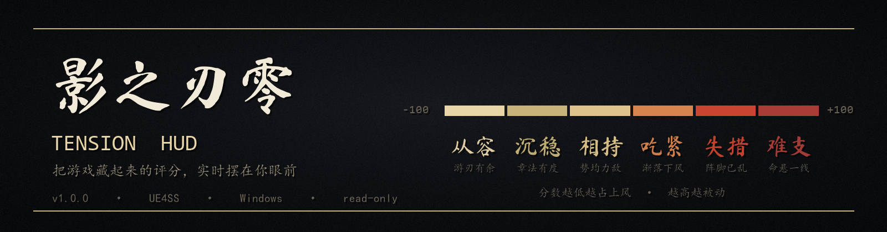
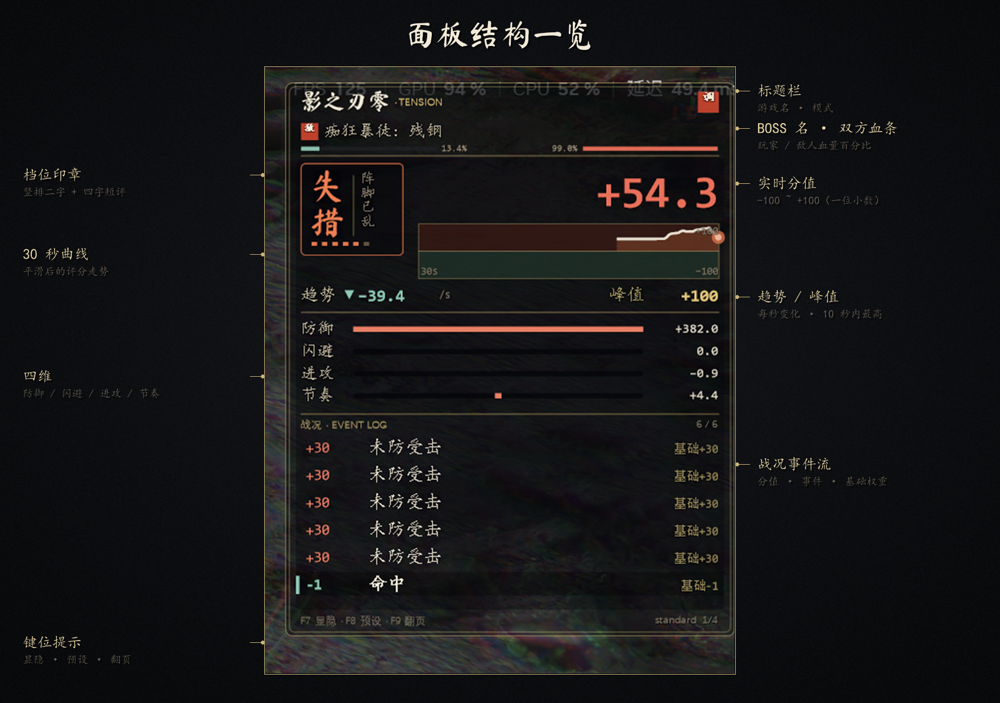
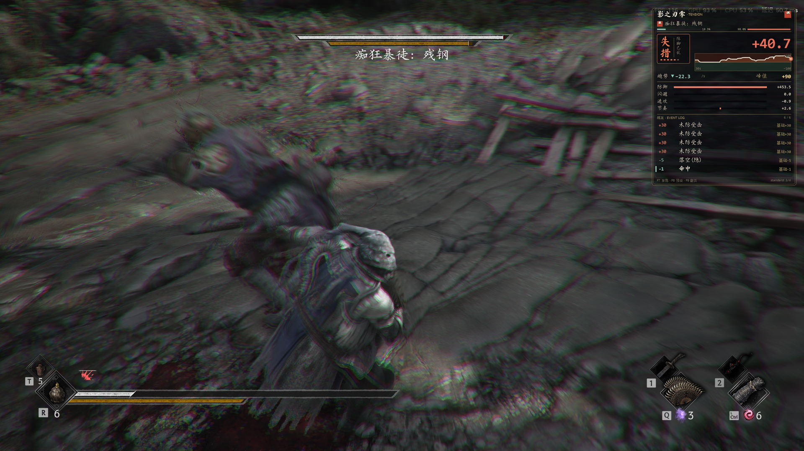
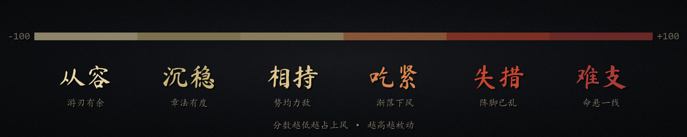
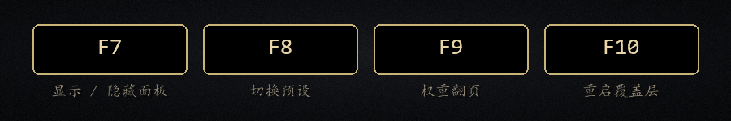
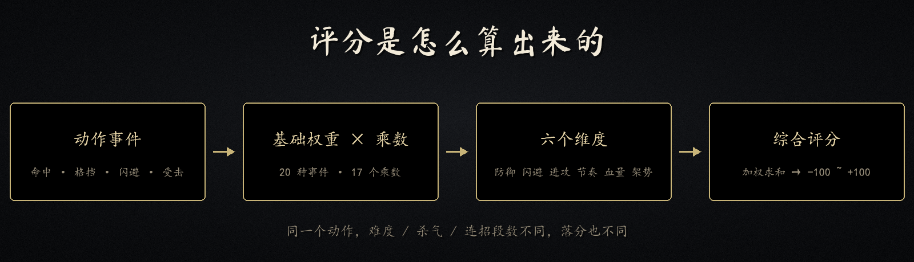
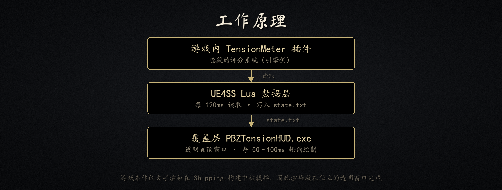

<div align="center">
  
</div>

<h1 align="center">Tension HUD</h1>

<p align="center">
  <b>把《影之刃零》藏起来的受压评分，实时摆在你眼前。</b><br>
  <sub>一款纯只读的战斗信息覆盖层 · UE4SS Lua + 独立透明窗口</sub>
</p>

<p align="center">
  
  
  
  
  
  
</p>

<p align="center">
  <a href="#-它是什么">它是什么</a> ·
  <a href="#-界面一览">界面</a> ·
  <a href="#-功能">功能</a> ·
  <a href="#-安装">安装</a> ·
  <a href="#-评分是怎么算的">评分原理</a> ·
  <a href="#-常见问题">常见问题</a> ·
  <a href="#-从源码构建">源码</a>
</p>

---

## ✨ 它是什么

《影之刃零》内部藏着一套**不显示给玩家**的评分系统——`Tension`（受压评分）。

你在 BOSS 战里做的每一个动作（击中、格挡、闪避、被打）都会按一张隐藏的事件表折算成分数，范围 **−100 ~ +100**，并划分成六个档位。游戏从不把它显示出来，但它决定着你此刻是压着 BOSS 打，还是被 BOSS 压着打。

**Tension HUD 把这套数值实时放到屏幕上。**

```
低分 ← ────────────────────────────── → 高分
从容    沉稳    相持    吃紧    失措    难支
你占上风                              你被动
```

> [!NOTE]
> **纯只读。** 本 mod 不写存档、不修改游戏数值、不改变平衡，也不碰游戏渲染管线——
> 它只是把引擎里已经存在的状态读出来画在屏幕上。

---

## 🖼 界面一览

<div align="center">
  
</div>

游戏内实机效果（玩家视角，右上角即 HUD）：

<div align="center">
  
</div>

---

## 🎯 功能

| 模块 | 内容 |
|---|---|
| **实时分值** | −100 ~ +100，一位小数，随动作即时跳动 |
| **档位状态** | 六个档位 + 四字短评，印章式竖排大字 |
| **30 秒曲线** | 平滑后的评分走势，一眼看出局势拐点 |
| **趋势 / 峰值** | 每秒变化量（Δ/s）与最近 10 秒峰值 |
| **四维分布** | 防御 / 闪避 / 进攻 / 节奏 的维度累计 |
| **战况事件流** | 每个动作一行：分值 · 事件名 · 基础权重，同屏 6 行 |
| **权重表** | 20 条基础权重，分 4 页翻看 |
| **双层血条** | 玩家 / BOSS 血量百分比 |

### 六个档位

<div align="center">
  
</div>

### 键位

<div align="center">
  
</div>

> `F7` 面板默认隐藏，进入 BOSS 战后手动呼出。

---

## 🚀 安装

### 前置要求

| 项目 | 说明 |
|---|---|
| 《影之刃零》Steam 版 | 版本需与 mod 适配的一致 |
| **UE4SS 3.0.1** | 游戏目录下存在 `platform\steam\dwmapi.dll` |
| .NET Framework 4.x | Win10 / Win11 自带，一般无需安装 |

### 三步安装

1. **下载**：从右侧 [Releases](../../releases) 下载最新 `PBZTensionHUD-v1.0.0.zip`
2. **解压**：关闭游戏，把压缩包拖进 `模组管理器UEModManager`，或解压到游戏根目录
   ```
   <游戏根目录>\platform\steam\ue4ss\Mods\PBZTensionHUD\Scripts\main.lua
   ```
3. **启动**：进游戏，进 BOSS 战，按 `F7`

> [!TIP]
> 解压后可直接双击 `docs\检查环境.bat`，它会自动检查 UE4SS、共享库、mod 本体和覆盖层是否就位。

### 卸载

删除 `platform\steam\ue4ss\Mods\PBZTensionHUD\` **整个目录**即可。

临时关闭：把目录里的 `enabled.txt` 改名为 `enabled.txt.disabled`，重启游戏。

> [!WARNING]
> 只改**文件夹名字**是没有用的——UE4SS 会扫描 `Mods/` 下任何含 `enabled.txt` 的子目录。
> 改名后 mod 仍然会被加载，还会因为找不到 exe 而进入「Lua 在跑、没有面板」的中间状态。

---

## 🧠 评分是怎么算的

<div align="center">
  
</div>

```
动作事件 → 查基础权重（20 种）→ 乘 17 个乘数 → 归入 6 个维度之一
        → 维度累计 → 加权求和 + 模式加成 → 最终分值（−100 ~ +100）
```

几个容易误解的点：

- **面板上的四维不是全部。** 游戏实际有 6 个维度（防御、闪避、进攻、节奏、血量、架势），面板只显示前 4 个。
- **四维相加 ≠ 总分。** 中间还有 17 个乘数（难度、杀气、连招段数……）和模式加成。
- **评分不直接驱动 BOSS。** A/B 实测中，评分与 BOSS 出招频率的相关性仅 **r = 0.24**。真正影响战斗走势的是杀气槽与硬直、AI 脚本（受击计数 / 概率门限）和难度设置。

> 完整的实测数据与推导过程见 [机制调研报告](docs/Tension机制调研报告.md) 与 [A/B 实验记录](docs/AB实验记录.md)。

---

## ❓ 常见问题

<details>
<summary><b>面板不出现？</b></summary>

1. 先按 `F10` 重启覆盖层
2. 确认 `F7` 是在 BOSS 战里按的（非战斗状态没有会话数据）
3. 仍无效：查看 `%TEMP%\PBZTensionHUD\overlay.log`
</details>

<details>
<summary><b>一直显示「未检测到 BOSS」？</b></summary>

只有 BOSS 战期间游戏才会创建会话（session）。普通探索时属于正常现象。
</details>

<details>
<summary><b>全屏看不到面板？</b></summary>

请使用「无边框全屏」或「窗口模式」。独占全屏下，覆盖层会被游戏画面遮挡。
</details>

<details>
<summary><b>会影响存档吗？</b></summary>

不会。本 mod 不调用任何存档接口，只读取 `TensionMeter` 子系统和角色属性。
</details>

<details>
<summary><b>和「首领再战」mod 冲突吗？</b></summary>

可以共存。两者没有依赖关系，hook 也都是只读的。

需要提醒的是：**首领再战 mod 自身**在「连战途中强杀游戏进程」时，有可能把竞技场状态写回战役存档。
这与本 mod 无关，但如果你两个都装，建议不要在对战进行中强制结束游戏。
</details>

<details>
<summary><b>杀毒软件报毒？</b></summary>

覆盖层是自制的未签名 exe，可能被误报。加入白名单即可；源码完全公开，可自行编译。
</details>

<details>
<summary><b>游戏更新后失效？</b></summary>

游戏内部结构变更会导致读不到数据，需要等待适配版本。
</details>

---

## 🛡 兼容性与安全性

| 项目 | 说明 |
|---|---|
| 存档 | ❌ 不读取、不写入任何存档数据 |
| 游戏数值 | ❌ 不修改任何属性、不注入数值 |
| 渲染管线 | ❌ 不在游戏内绘制（独立透明窗口） |
| 进程 | 覆盖层是独立 exe，游戏退出后自动结束 |
| 网络 | ❌ 不联网 |
| 其他 mod | ✅ 只读 hook，可共存 |

---

## 🛠 从源码构建

需要 .NET Framework 4.x 的 `csc.exe`：

```powershell
powershell -ExecutionPolicy Bypass -File src/build.ps1
```

产物 `src/PBZTensionHUD.exe` 放入 mod 的 `bin/` 目录即可。

### 仓库结构

```
├── src/
│   ├── main.lua             # UE4SS 数据层：读 Tension、写状态文件、拉起覆盖层
│   ├── TensionOverlay.cs    # 覆盖层：透明置顶窗口、GDI+ 绘制
│   └── build.ps1            # 一键编译
├── docs/
│   ├── 安装说明.txt          # 一页纸安装指南
│   ├── 使用手册.md           # 完整功能说明
│   ├── 检查环境.bat          # 前置条件自检
│   ├── Tension机制调研报告.md
│   ├── AB实验记录.md
│   └── images/
├── CHANGELOG.md
└── release/                 # 打包产物（随 Release 发布）
```

### 工作原理

<div align="center">
  
</div>

游戏本体的文字渲染在 Shipping 构建中被裁掉（`PrintString` / `TextRenderComponent` 调用即崩溃），
因此渲染放在一个**独立的透明置顶窗口**里完成，由 Lua 层每 120ms 写出的状态文件驱动。

---

## ⚠️ 已知限制

- 权重表显示的是**基础权重**，不含乘数结算后的最终值
- 架势 / 血量维度引擎未暴露，不显示
- 仅支持无边框全屏 / 窗口模式
- 游戏大版本更新后可能需要适配

---

## 📄 许可

- **代码**：[MIT](LICENSE)
- **字体**：标题与档位词使用 **马善政楷书（Ma Shan Zheng）**，遵循 [SIL OFL 1.1](https://scripts.sil.org/OFL)
- 正文中文使用系统楷体

## ⚖️ 免责声明

个人兴趣制作的非官方 mod，与游戏开发商 / 发行商无任何关联。
仅供学习与交流，请支持正版游戏。

---

<details>
<summary><b>English summary</b></summary>

**Tension HUD** is a read-only HUD overlay for *Phantom Blade Zero* that displays the game's hidden
**Tension** scoring system (−100 … +100, six tiers) during boss fights.

It reads the engine's hidden `TensionMeter` subsystem through a UE4SS Lua mod and renders the values in
a separate click-through top-most window (C#, GDI+). Nothing is written to saves, and no game values are modified.

- **Requires:** Windows, the Steam version of the game, [UE4SS](https://github.com/UE4SS-RE/RE-UE4SS) 3.0.1, .NET Framework 4.x
- **Install:** download the latest release, extract into the game root, press `F7` in a boss fight
- **Keys:** `F7` toggle · `F8` preset · `F9` weight pages · `F10` restart overlay
- **License:** MIT (code) · SIL OFL 1.1 (bundled font)

The score does **not** drive boss AI (measured r = 0.24). What actually matters is the shachi/stagger
gauge, the AI scripts and the difficulty setting — see the research notes (Chinese) in `docs/`.
</details>
